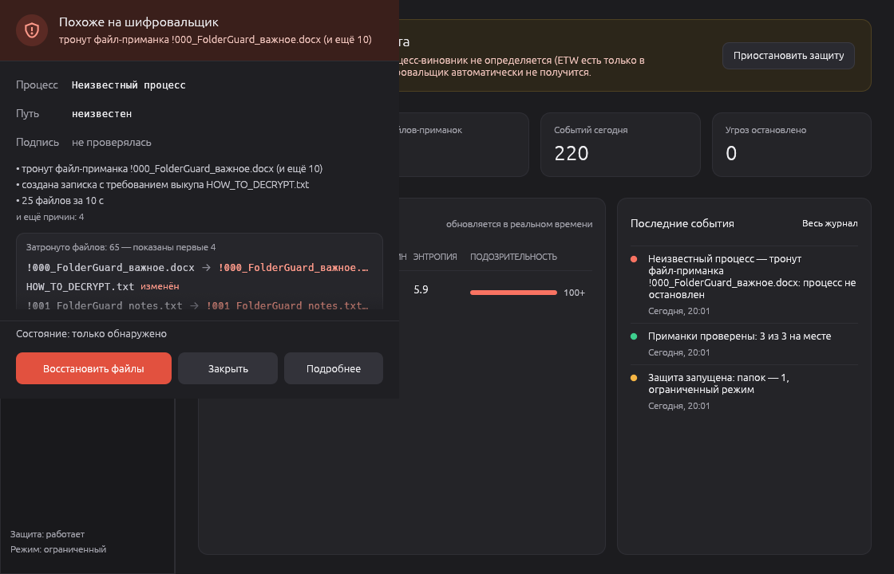

<p align="center">
  
</p>

<h1 align="center">Folder Guard</h1>

<p align="center">
  Ransomware protection for Windows folders: detects an attack by behavior, freezes the process and restores files from backup.
</p>

<p align="center">
  <a href="https://github.com/YOUR_GITHUB_USERNAME/folder-guard/actions/workflows/ci.yml"></a>
  <a href="https://github.com/YOUR_GITHUB_USERNAME/folder-guard/releases/latest"></a>
  
  
</p>

<p align="center">
  <a href="README.md">Русский</a> · <b>English</b>
</p>

> The user interface is in Russian. The main documentation is in [README.md](README.md); this page is a short summary.



## How it works

- **Canary files.** Hidden decoy files named `!000_…` and `zz_…` are placed in every protected folder.
  Ransomware walking a folder alphabetically hits them first; users never touch them. Any change is a critical alert.
- **Behavior analysis via ETW.** `Microsoft-Windows-Kernel-File` reports every write, rename and delete together with
  the process ID. Each process collects suspicion points over a one-minute window:

  | Signal | Points |
  |---|---|
  | Canary file touched | 100 |
  | Shadow copy deletion (`vssadmin delete shadows`, …) | 100 |
  | Burst: 25 files in 10 seconds | 30 |
  | Ransom notes in several folders | 25 |
  | Broken file signature (`.docx` without `PK`, …) | 15 |
  | High entropy (≥ 7.5 bits/byte) in a text file | 15 |
  | Rename to an unknown extension (`.docx` → `.docx.locked`) | 10 |

- **Response.** At 50 points the process is suspended and a notification asks "Kill / Allow / Details".
  At 100 points an always-on-top alert window opens. Without an answer the process is killed after 30 seconds.
- **Backups.** Changed files are copied to a versioned store; files that already look encrypted are skipped.
  "Kill and restore" brings back the versions taken before the attack and moves encrypted files to quarantine.

Also: process allow-list, excluded folders (`target`, `node_modules`, …), learning mode, SQLite journal,
tray icon, autostart. Critical system processes are never suspended.

## Install

Download the zip from [Releases](https://github.com/YOUR_GITHUB_USERNAME/folder-guard/releases/latest), unpack it and run
`folder-guard.exe` **as administrator** (ETW requires it; without admin rights the app runs in a limited mode that
cannot identify the offending process). The exe is not code-signed, so SmartScreen may show a warning.

## Build

```powershell
cargo build --release   # Rust 1.95+, Visual Studio Build Tools (C++)
```

## Test safely

`ransim` is a harmless simulator that only works inside a sandbox folder it created itself:

```powershell
.\ransim.exe init C:\fg-test
Start-Process .\folder-guard.exe -Verb RunAs -ArgumentList '--protect','C:\fg-test','--data-dir','C:\fg-test-data'
.\ransim.exe attack C:\fg-test
```

## Limitations

Not a replacement for an antivirus. Detection happens after the write, so a few files may be damaged before
the process is frozen; an administrator-level process can stop Folder Guard. Keep backups on another drive.

## License

MIT or Apache 2.0, at your option.
