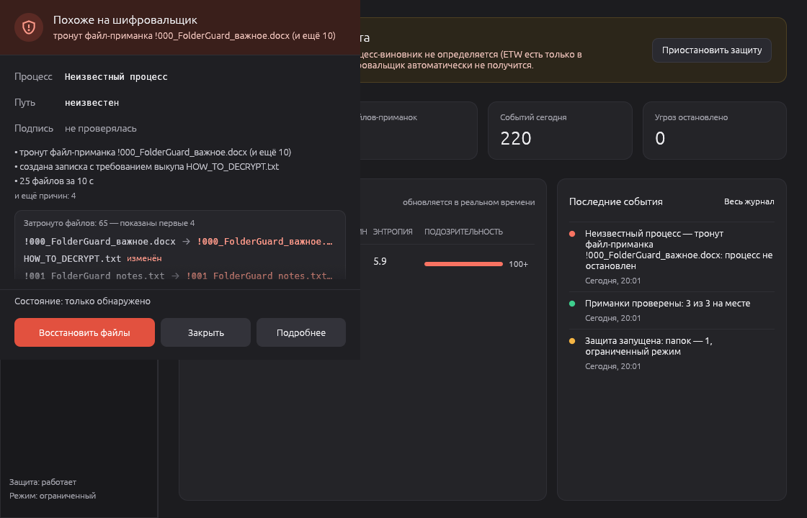
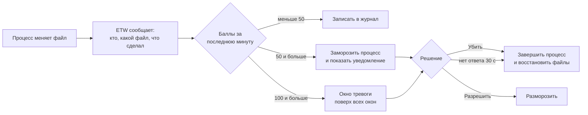
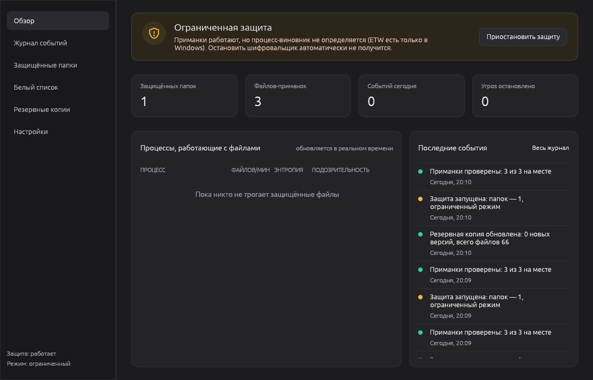
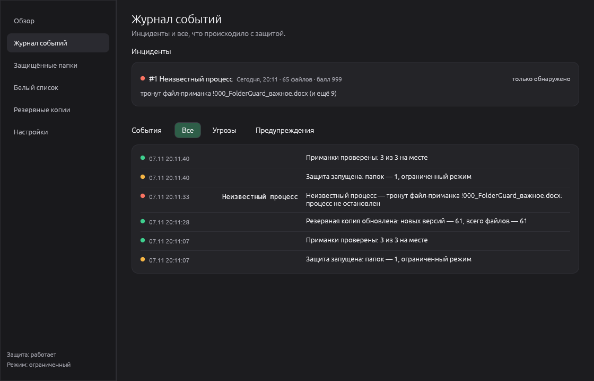
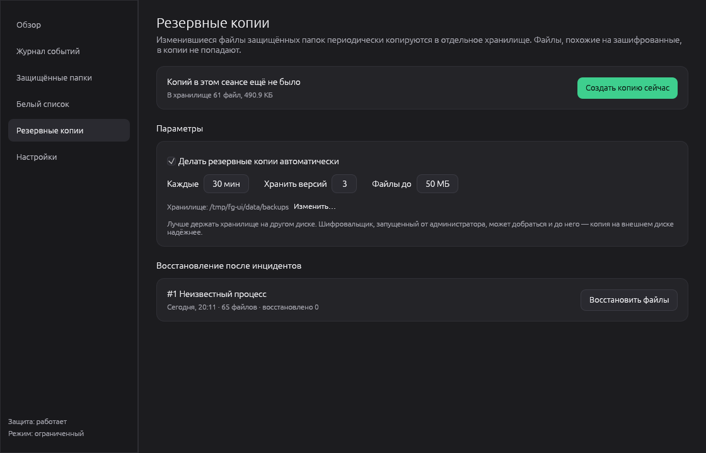
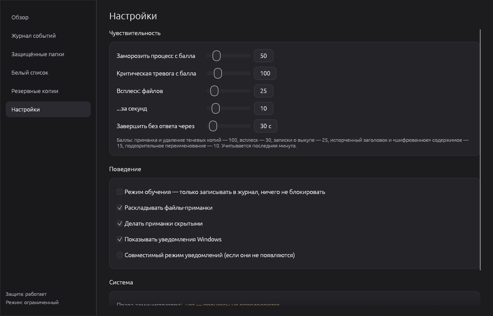
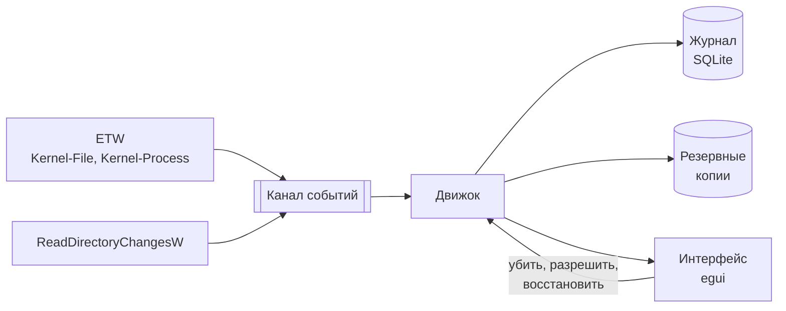

<div align="center">


# Folder Guard

**Защита папок Windows от шифровальщиков.**<br>
Замечает атаку по поведению, замораживает процесс и возвращает файлы из резервной копии.

[](https://github.com/lsdasy/folder-guard/actions/workflows/ci.yml)
[](https://github.com/lsdasy/folder-guard/releases/latest)


[](#лицензия)

[Скачать](https://github.com/lsdasy/folder-guard/releases/latest) ·
[Как это работает](#как-это-работает) ·
[Проверить на симуляторе](#проверка-на-симуляторе) ·
[Вопросы](#частые-вопросы) ·
[English](README.en.md)



</div>

## Зачем это нужно

Шифровальщик за минуту превращает документы, фото и курсовые в мусор и требует выкуп.
Антивирус узнаёт такие программы по базе сигнатур, поэтому новая или переделанная версия может проскочить.

Folder Guard не ищет сигнатуры, а смотрит на **поведение**. Любой шифровальщик делает одно и то же:
массово переписывает файлы случайными данными, меняет им расширения, оставляет записки о выкупе
и удаляет теневые копии Windows. Как только программа видит такую картину, она останавливает процесс.

## Возможности

| | |
|---|---|
| **Файлы-приманки** | Скрытые файлы в каждой папке. Шифровальщик натыкается на них первыми, а человек никогда их не трогает. |
| **Анализ поведения** | Через ETW видно, какой процесс что пишет. Каждому процессу начисляются баллы подозрительности. |
| **Заморозка, а не убийство** | Подозрительный процесс сначала замораживается. Если тревога ложная, его можно разморозить без потерь. |
| **Резервные копии** | Несколько версий каждого файла. Восстановление в один клик, зашифрованное уходит в карантин. |
| **Без лишнего шума** | Белый список (7-Zip, git, cargo, OneDrive…), исключения (`node_modules`, `target`…), режим обучения. |
| **Работает в фоне** | Значок в трее, уведомления с кнопками, автозапуск, журнал событий. |

## Быстрый старт

1. Скачайте `folder-guard-…-windows-x64.zip` со страницы
   [**Releases**](https://github.com/lsdasy/folder-guard/releases/latest) и распакуйте. Установка не нужна.
2. Запустите `folder-guard.exe` **от имени администратора**: правый клик → «Запуск от имени администратора».
3. Готово. По умолчанию защищены «Документы», «Рабочий стол» и «Изображения».
   Добавить свои папки можно в разделе «Защищённые папки».

> [!NOTE]
> Exe не подписан сертификатом, поэтому Windows SmartScreen может предупредить о неизвестном издателе:
> «Подробнее» → «Выполнить в любом случае». Если не доверяете готовой сборке, [соберите из исходников](#сборка-из-исходников)
> и сверьте контрольные суммы из `SHA256SUMS.txt`.

> [!IMPORTANT]
> Без прав администратора программа работает в **ограниченном режиме**: приманки срабатывают,
> но определить и остановить процесс-виновник нельзя. В интерфейсе для этого есть кнопка
> «Перезапустить от администратора».

## Как это работает



За что начисляются баллы:

| Признак | Баллы |
|---|:---:|
| Изменена или удалена приманка | **100** |
| Удаление теневых копий (`vssadmin delete shadows`, `wmic shadowcopy delete`…) | **100** |
| Всплеск: 25 файлов за 10 секунд | 30 |
| Записки о выкупе (`HOW_TO_DECRYPT.txt`…) в нескольких папках | 25 |
| Испорченная сигнатура формата: `.docx` без `PK`, `.png` без `‰PNG` | 15 |
| Высокая энтропия (≥ 7,5 бит/байт) у текстового файла: он выглядит как шифр | 15 |
| Переименование в неизвестное расширение: `отчёт.docx` → `отчёт.docx.locked` | 10 |

Пороги, окно всплеска и время до автоматического завершения настраиваются.
Системные процессы (`explorer.exe`, `svchost.exe`, `lsass.exe`…) никогда не замораживаются,
иначе зависнет Windows: по ним только предупреждение.

### Восстановление

Раз в 30 минут изменившиеся файлы защищённых папок копируются в отдельное хранилище,
по 3 версии на файл. Файлы, которые уже выглядят зашифрованными, в копию не попадают,
поэтому испорченная версия не вытеснит хорошие.

Кнопка «Убить и восстановить файлы» возвращает версии, сделанные **до начала атаки**,
а зашифрованные файлы переносит в карантин. Ничего не удаляется безвозвратно.

## Скриншоты

<table>
  <tr>
    <td></td>
    <td></td>
  </tr>
  <tr>
    <td align="center">Обзор</td>
    <td align="center">Журнал событий</td>
  </tr>
  <tr>
    <td></td>
    <td></td>
  </tr>
  <tr>
    <td align="center">Резервные копии</td>
    <td align="center">Настройки</td>
  </tr>
</table>

<sub>Скриншоты сняты при разработке на Linux, поэтому на них «ограниченный режим» и шрифт Ubuntu. В Windows используется Segoe UI.</sub>

## Проверка на симуляторе

В комплекте есть `ransim.exe`, безопасный симулятор шифровальщика. Он работает **только** в папке-песочнице,
которую создал сам (в ней лежит файл-метка), и не умеет трогать другие файлы.
Всё равно лучше запускать его в виртуальной машине.

```powershell
# 1. Создать песочницу с тестовыми документами
.\ransim.exe init C:\fg-test

# 2. Защищать только песочницу, данные хранить отдельно
Start-Process .\folder-guard.exe -Verb RunAs -ArgumentList '--protect','C:\fg-test','--data-dir','C:\fg-test-data'

# 3. Подождать ~30 секунд (сделается первая копия) и «атаковать»
.\ransim.exe attack C:\fg-test --delay-ms 50
```

**Что должно произойти:** симулятор замораживается на первом же файле (приманка `!000_…` идёт первой по алфавиту),
появляется окно «Похоже на шифровальщик». «Убить и восстановить файлы» завершает процесс и возвращает документы.

## Сборка из исходников

Нужны [Rust](https://rustup.rs) 1.95+ и Visual Studio Build Tools с компонентом
«Разработка классических приложений на C++» (установщик Rust предложит их сам).

```powershell
git clone https://github.com/lsdasy/folder-guard
cd folder-guard
cargo build --release
```

Готовые файлы: `target\release\folder-guard.exe` и `target\release\ransim.exe`.
Тесты: `cargo test`. Один из них прогоняет полный цикл на настоящем процессе:
заморозка → завершение → восстановление из копии → карантин → починка приманок.

<details>
<summary><b>Параметры командной строки</b></summary>

| Параметр | Что делает |
|---|---|
| `--minimized` | запуск свёрнутым в трей (так запускает автозапуск) |
| `--protect ПАПКА` | защищать эту папку вместо папок из настроек (можно указать несколько раз) |
| `--data-dir ПАПКА` | хранить настройки, журнал и копии в этой папке |
| `--headless` | без интерфейса, события выводятся в консоль |
| `--page РАЗДЕЛ` | открыть раздел: `overview`, `journal`, `folders`, `whitelist`, `backups`, `settings` |
| `--version` | показать версию |

</details>

<details>
<summary><b>Устройство программы</b></summary>



Движок работает в отдельном потоке и не зависит от окна, поэтому защита продолжается,
когда окно свёрнуто в трей.

| Модуль | Назначение |
|---|---|
| [`monitor/etw.rs`](src/monitor/etw.rs) | ETW-сессия: какой процесс пишет, переименовывает, удаляет файлы; запуск процессов |
| [`monitor/watcher.rs`](src/monitor/watcher.rs) | наблюдение за папками без прав администратора |
| [`engine.rs`](src/engine.rs) | сопоставляет события, открывает инциденты, принимает решения |
| [`scoring.rs`](src/scoring.rs) | баллы подозрительности, детектор всплесков |
| [`analysis.rs`](src/analysis.rs) | энтропия, сигнатуры форматов, переименования, записки о выкупе |
| [`canary.rs`](src/canary.rs) | файлы-приманки |
| [`backup.rs`](src/backup.rs) | хранилище версий файлов и восстановление |
| [`journal.rs`](src/journal.rs) | журнал событий и инцидентов |
| [`platform/windows.rs`](src/platform/windows.rs) | заморозка (`NtSuspendProcess`), завершение, проверка подписи, уведомления, UAC, автозапуск |
| [`tray.rs`](src/tray.rs) | значок и меню в трее |
| [`ui/`](src/ui) | главное окно, разделы, окно тревоги |
| [`bin/ransim.rs`](src/bin/ransim.rs) | безопасный симулятор атаки |

</details>

## Частые вопросы

<details>
<summary><b>Это замена антивирусу?</b></summary>

Нет. Это дополнительный слой защиты от одного конкретного типа угроз. Хорошо сочетается со встроенной функцией
Защитника Windows «Контролируемый доступ к папкам»: она пускает к папкам только разрешённые программы,
а Folder Guard следит за поведением тех, кого пустили.
</details>

<details>
<summary><b>Почему нужны права администратора?</b></summary>

Определить, какой именно процесс меняет файлы, можно только через ETW, а это требует прав администратора.
Без них программа видит, что файлы меняются, но не знает кем, и остановить виновника не может.
</details>

<details>
<summary><b>Что будет, если программа ошибётся?</b></summary>

Процесс сначала **замораживается**, а не завершается. Нажмите «Разрешить», и он продолжит работу с того же места.
Чтобы программа больше не тревожила, выберите «Разрешить всегда» в журнале или добавьте её в белый список.
Для первых дней есть режим обучения: всё пишется в журнал, но ничего не блокируется.
</details>

<details>
<summary><b>Шифровальщик всё-таки испортит какие-то файлы?</b></summary>

Да, несколько штук успеют пострадать: реакция происходит после записи. Поэтому важны приманки
(часто шифровальщик натыкается на них первыми) и резервные копии, из которых эти файлы возвращаются.
</details>

<details>
<summary><b>Тормозит ли компьютер?</b></summary>

В обычной работе почти незаметно: программа получает события от Windows и смотрит только на защищённые папки.
Резервное копирование идёт раз в 30 минут и копирует только изменившиеся файлы.
</details>

<details>
<summary><b>Где хранятся данные и как удалить программу?</b></summary>

- Настройки: `%APPDATA%\FolderGuard\config\config.toml`.
- Журнал, резервные копии, карантин: `%LOCALAPPDATA%\FolderGuard\data\`.

Чтобы удалить программу: в «Настройках» выключите автозапуск и «Раскладывать файлы-приманки» (приманки удалятся),
выйдите через меню в трее, затем удалите exe и две папки выше.
</details>

## Ограничения

- Процесс с правами администратора может завершить Folder Guard и добраться до резервных копий.
  Храните копии на другом диске (это настраивается).
- Запись через отображение файла в память ETW не видит как запись. Для приманок есть подстраховка
  через наблюдение за папками.
- Версия 0.1: обнаружение через ETW нужно проверить на разных сборках Windows. Если что-то работает не так,
  [создайте issue](https://github.com/lsdasy/folder-guard/issues/new/choose) и приложите строки из журнала.

## Планы

- [ ] Служба Windows, которая работает до входа пользователя, и отдельное приложение в трее
- [ ] Самозащита от остановки обычным процессом
- [ ] Minifilter-драйвер: блокировать запись **до** того, как она случилась
- [ ] Цифровая подпись exe

## Участие в разработке

Ошибки и идеи — в [issues](https://github.com/lsdasy/folder-guard/issues).
Как собрать проект и прислать изменения — в [CONTRIBUTING.md](CONTRIBUTING.md).

> [!WARNING]
> Нашли способ обойти защиту? Не публикуйте его в issues: сообщите приватно по инструкции из [SECURITY.md](SECURITY.md).

## Лицензия

На выбор: [MIT](LICENSE-MIT) или [Apache 2.0](LICENSE-APACHE).

© 2026 Kir ([@lsdasy](https://github.com/lsdasy))
